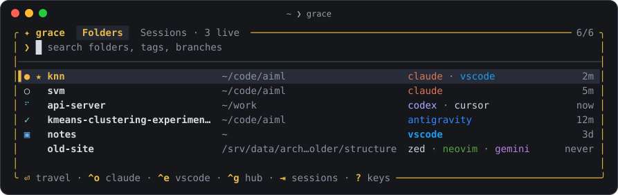
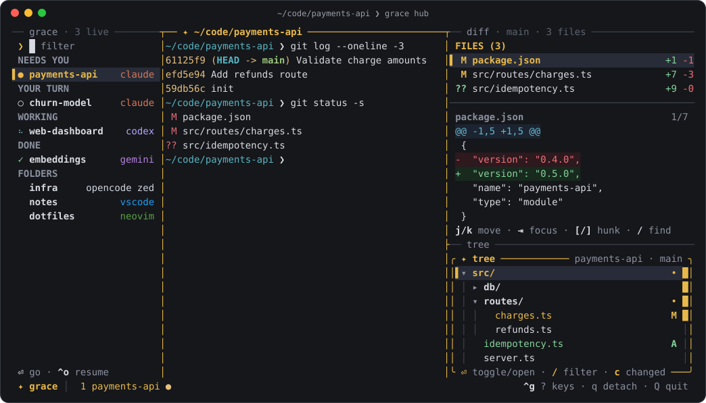
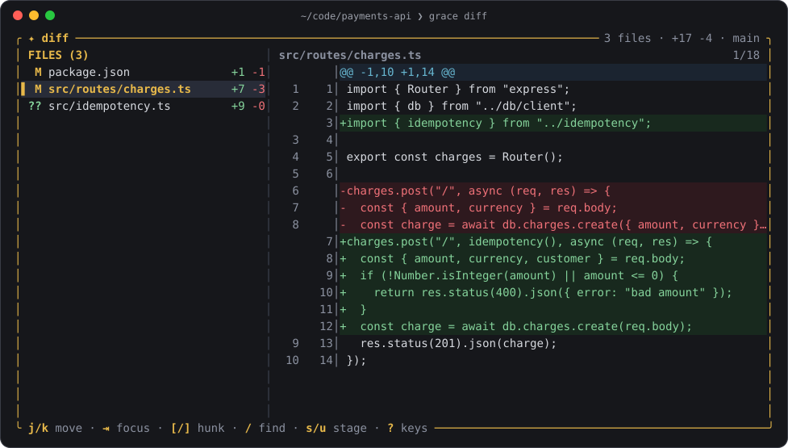
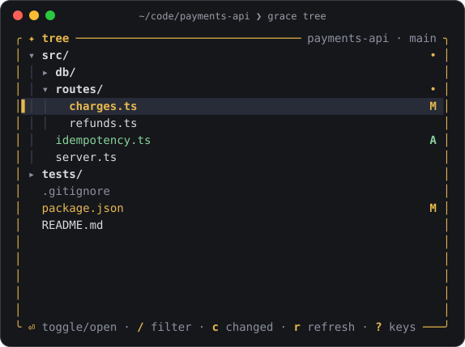

<div align="center">


# grace

**Fast travel for your terminal.**

[](https://github.com/prathameshk421/grace/actions/workflows/ci.yml)
[](https://github.com/prathameshk421/grace/releases/latest)
[](#license)

[](https://claude.com/claude-code)

[Quick start](#quick-start) · [Hub](#the-hub) · [Install](#install) · [Usage](#usage) · [Tools](#tools-and-import-sources) · [How it works](#how-it-works)

<br>



</div>

## Every folder. One keystroke away.

You have projects on many disks. You forget where they are. You switch between AI tools and lose track of which one you used where. grace remembers for you.

In Elden Ring, you rest at a Site of Grace and fast travel to any grace you found. grace does the same for your terminal.

## Quick start

**1. Install.** Pick the line for your system.

Linux and macOS:

```sh
curl -fsSL https://raw.githubusercontent.com/prathameshk421/grace/main/install.sh | sh
```

Windows (PowerShell):

```powershell
irm https://raw.githubusercontent.com/prathameshk421/grace/main/install.ps1 | iex
```

Homebrew (macOS and Linux):

```sh
brew install prathameshk421/grace/grace
```

**2. Connect your shell.** The installer prints the line for your shell. For zsh:

```sh
echo 'eval "$(grace init zsh)"' >> ~/.zshrc
```

**3. Open a new terminal and type `grace`.** The first run imports your Claude Code and editor history, so your list is full on day one.

Other shells, downloads and source builds are in [Install](#install).

## Highlights

| | |
|---|---|
| **~13 ms** | One hook call. It runs in the background, so the prompt does not wait. |
| **13 + 11** | 13 AI tools and 11 editors built in. |
| **3 systems, 4 shells** | macOS, Linux, Windows. zsh, bash, fish, PowerShell. |
| **7 sources** | Claude Code, VS Code, Cursor, Windsurf, Antigravity, Zed and T3 Code history. |
| **0 config** | Install, add one line to your shell, and go. |
| **1 window** | `grace hub` puts your agents, shell, diff and file tree side by side. |
| **1 binary** | Written in Rust. Local SQLite. Nothing leaves your machine. |

## Fast travel.

Type `grace` to open the picker. Type to filter, press Enter, and your shell moves there. If your word matches only one folder, grace jumps at once.

```sh
grace          # open the picker
grace knn      # one match: go there now
```

## The hub

`grace hub` opens one terminal window for all your projects. It is built on tmux.

<p align="center">
  
</p>

- **Left:** the sidebar. Live agents come first, grouped by status. Your folders follow, best first. Type to filter.
- **Middle:** your own shell in the folder. Run claude, codex or any CLI as usual.
- **Right:** a live git diff on top and a file tree below. Both follow the folder of the window.

Each folder gets its own workspace: a tmux window with its own shell. Agents keep running when you switch. Press Enter on a folder in the sidebar to switch to it. Press ctrl-o to switch and start the AI tool you used there last. The status bar shows each workspace with the status of its agent.

```sh
grace hub              # open the hub in this folder
grace hub ~/code/knn   # open the hub, or switch to that folder
```

### Keys

Press **ctrl-g**, then one key. No tmux prefix needed.

| Key | What it does |
|---|---|
| `s` | Show or hide the sidebar |
| `d` | Show or hide the diff |
| `t` | Show or hide the file tree |
| `r` | Show or hide the whole right side |
| `z` | Zoom the main pane, or zoom out |
| `g` | Go to the sidebar |
| `q` | Detach. The hub keeps running. Run `grace hub` to come back. |
| `Q` | Quit the hub. It asks first, then closes every workspace. |
| `?` | Show all keys |
| `ctrl-g` | Send ctrl-g to the program |

### Leave the hub

| To | Do this |
|---|---|
| Leave for now, with agents still running | `ctrl-g q`. Run `grace hub` to come back. |
| Stop the hub and every shell in it | `ctrl-g Q`, then `y`. Or run `grace hub quit` in any terminal. |
| Close one workspace | Type `exit` in its shell. |
| Hide the diff or the tree | Press `q` in that pane, or `ctrl-g d` or `ctrl-g t`. |

The status bar shows these keys at the bottom right.

A pane that comes back takes its old place and size. grace remembers which panes you show and uses that for new workspaces and the next start. The mouse works too: click a pane to focus it, drag a border to resize it.

### Requirements

The hub needs tmux 3.2 or newer. It works on macOS and Linux. On Windows, run grace inside WSL.

```sh
brew install tmux          # macOS
sudo apt install tmux      # Debian, Ubuntu
```

grace runs tmux on its own server (`tmux -L grace`) with its own config file. Your tmux server and `~/.tmux.conf` stay as they are. The hub also works inside another tmux.

### Diff and tree without the hub

`grace diff` and `grace tree` also work on their own, on all three systems.

<table>
  <tr>
    <td width="64%"></td>
    <td width="36%"></td>
  </tr>
</table>

```sh
grace diff     # changed files and a colored diff. j/k move, tab switches focus, q quits.
grace tree     # files with git changes marked. enter opens a folder, o opens a file.
```

`grace diff` shows untracked files as added. It cuts very long diffs. `grace tree` hides the files that `.gitignore` lists. Outside a git repository, it skips `.git`, `node_modules` and `target`.

## See which agent needs you.

Run Claude Code, Codex and other CLI agents in many projects at once. `grace sessions` lists the live ones. The agents that need you come first.

```
grace ❯
  ~/code/aiml/knn        [claude]   ● needs you     2m
  ~/code/aiml/svm        [claude]   ○ your turn     5m
  ~/work/api-server      [codex]    ⠋ working       now
  ~/code/aiml/kmeans     [agy]      ✓ done          12m
```

"Needs you" means the agent is blocked on a question or a permission. "Your turn" means it finished.

```sh
grace setup claude     # Claude Code CLI reports its status to grace
grace setup codex      # Codex CLI reports when a turn ends
grace sessions         # picker with live agents only
grace sessions -l      # plain list
```

`grace setup <cli>` connects 11 CLI agents:

| CLI | Setup | needs you | your turn | working | done |
|---|---|:-:|:-:|:-:|:-:|
| Claude Code | `grace setup claude` | ✓ | ✓ | ✓ | ✓ |
| Qwen Code | `grace setup qwen` | ✓ | ✓ | ✓ | ✓ |
| GitHub Copilot CLI | `grace setup copilot` | ✓ | ✓ | ✓ | ✓ |
| Crush | `grace setup crush` | ✓ | ✓ | ✓ | ✓ |
| OpenCode | `grace setup opencode` | ✓ | ✓ | ✓ | ✓ |
| Gemini CLI | `grace setup gemini` | ✓ | ✓ | ✓ | ✓ |
| Antigravity CLI | `grace setup agy`, then `agy plugin enable grace` | | ✓ | ✓ | shell |
| Goose | `grace setup goose` | | ✓ | ✓ | ✓ |
| Amp | `grace setup amp` | | ✓ | ✓ | shell |
| Codex CLI | `grace setup codex` | | ✓ | shell | shell |
| Aider | `grace setup aider` | | ✓ | shell | shell |

"shell" means the zsh or fish hook covers it. A blank cell means the CLI does not report it. Cursor CLI and T3 Code show working and done through the shell hook.

`grace setup` makes a backup of the config first. `--remove` undoes it. The config calls grace by its full path. With Homebrew, that is the stable `/opt/homebrew/bin/grace`, so upgrades keep working. If you move grace to another place, for example from cargo to Homebrew, run `grace setup <cli>` again. If Codex already has a `notify` program, `grace setup codex` keeps it and forwards each event to it. In zsh and fish, grace also sees every AI CLI start and exit, with no setup.

## Tags show where you worked.

Each folder shows the AI tools and editors you used in it. Each tag has the color of its tool's logo. Filter by tag to see only the folders where you used one tool.

```sh
grace -t claude
```

## Jump back to your editor.

If VS Code, Cursor, Windsurf or Antigravity has a folder open, the picker marks it with `▣`. Press **ctrl-e** to bring that editor window to the front. Your shell stays where it is.

## Pick up where you stopped.

`grace -o`, or **ctrl-o** in the picker, travels to the folder and starts the AI tool you used there last.

```sh
grace -o
```

## History you already have.

On first run, grace imports recent folders from Claude Code, VS Code, Cursor, Windsurf, Antigravity, Zed and T3 Code. Your folder list is full on day one.

```sh
grace import           # all sources
grace import zed       # one source
```

## Your tools too.

Add any command as a tool. grace tags it and can launch it.

```sh
grace tool add kiro
grace tool add q --tag amazon-q --launch "q chat"
```

## Pin. Forget. Done.

Pin a folder to keep it at the top. Forget a folder to remove it.

```sh
grace pin
grace forget ~/old-project
```

## Private by design.

grace stores everything in a local SQLite file. It sends nothing over the network. It opens editor databases read-only and never changes your editor data. Folders that do not exist, such as an unplugged SSD, are hidden, not deleted. They return when the disk returns.

## Install

### Linux

Works on x86_64 and ARM64. No root needed.

```sh
curl -fsSL https://raw.githubusercontent.com/prathameshk421/grace/main/install.sh | sh
```

The script finds your CPU, downloads the latest release, checks its SHA-256 sum and puts `grace` in `~/.local/bin`. If that folder is not on your PATH, the script tells you the line to add. Set `GRACE_INSTALL_DIR` for another folder, or `GRACE_VERSION` for an older release.

### macOS

Use the same script as on Linux, or Homebrew:

```sh
brew install prathameshk421/grace/grace
```

Homebrew prints a short intro and the setup steps after the install. Run `brew upgrade grace` to update.

### Windows (PowerShell)

```powershell
irm https://raw.githubusercontent.com/prathameshk421/grace/main/install.ps1 | iex
```

### Other ways

**Download.** Get the archive for your system from the [Releases page](https://github.com/prathameshk421/grace/releases/latest). Asset names have the form `grace-<version>-<target>`.

| Your system | Archive |
|---|---|
| macOS Apple Silicon | `grace-<version>-aarch64-apple-darwin.tar.gz` |
| macOS Intel | `grace-<version>-x86_64-apple-darwin.tar.gz` |
| Linux x86_64 | `grace-<version>-x86_64-unknown-linux-gnu.tar.gz` |
| Linux ARM64 | `grace-<version>-aarch64-unknown-linux-gnu.tar.gz` |
| Windows x86_64 | `grace-<version>-x86_64-pc-windows-msvc.zip` |

macOS and Linux: extract the archive and move `grace` into a folder on your PATH.

```sh
tar -xzf grace-*.tar.gz
mv grace-*/grace ~/.local/bin/
```

The macOS binary is not signed. If macOS blocks it, run this:

```sh
xattr -d com.apple.quarantine ~/.local/bin/grace
```

Windows: extract `grace.exe` into a folder on your PATH, for example `%USERPROFILE%\bin`. Add that folder to PATH if it is not there yet.

**Build from source.** You need Rust.

```sh
cargo install --git https://github.com/prathameshk421/grace
```

### Set up your shell

1. Pick your shell in the table. Add the line to the file.
2. Open a new terminal.
3. Run `grace`. On the first run, grace imports your Claude Code and editor history.

| Shell | Line | File |
|---|---|---|
| zsh | `eval "$(grace init zsh)"` | `~/.zshrc` |
| bash | `eval "$(grace init bash)"` | `~/.bashrc` |
| fish | `grace init fish \| source` | `~/.config/fish/config.fish` |
| PowerShell | `Invoke-Expression (& grace init powershell \| Out-String)` | `$PROFILE` |

### Uninstall

1. Remove the `grace init` line from your shell file.
2. If you ran `grace setup`, run `grace setup <cli> --remove` for each CLI.
3. Remove the program: `brew uninstall grace`, or delete `~/.local/bin/grace`. On Windows, delete `%LOCALAPPDATA%\grace\bin\grace.exe`.
4. Optional: delete your data, `~/.local/share/grace` (Windows: `%LOCALAPPDATA%\grace`).

## Usage

| Command | What it does |
|---|---|
| `grace` | Open the picker. Type to filter, Enter to travel. |
| `grace knn` | Start the picker with "knn". If only one folder matches, go there at once. |
| `grace -t claude` | Show only folders where you used Claude. |
| `grace -o` | Travel, then start the AI tool you used last in that folder. |
| `grace --full` | Open the picker in full screen. |
| `grace hub [path]` | Open the hub on tmux: sidebar, shell, diff and file tree. Inside the hub, switch to the folder. |
| `grace diff [path]` | Show the changed files of a git repository and a colored diff. |
| `grace tree [path]` | Show the files of a folder as a tree, with git changes marked. |
| `grace list` | Print all folders, best first. |
| `grace pin` / `grace unpin` | Keep the current folder at the top (or remove the pin). |
| `grace forget` | Remove the current folder from grace. |
| `grace import [source]` | Import history again. Sources: `all` (default), `claude`, `vscode`, `cursor`, `windsurf`, `antigravity`, `zed`, `t3code`. |
| `grace tag <path> <tool> [target]` | Record a tool run. The shell hook calls this. |
| `grace tool add` / `list` / `rm` | Add, list or remove your own tools. |
| `grace --help` | Show all commands and options. |

Each command that takes a folder also accepts a path, for example `grace forget ~/old-project`.

### Tools and import sources

**AI tools (13).** `claude`, `agy` / `antigravity`, `codex`, `gemini`, `cursor` / `cursor-agent`, `opencode`, `aider`, `copilot`, `amp`, `goose`, `crush`, `qwen`, `t3` (tag `t3code`, T3 Code).

**Editors (11).** `code` and `code-insiders` (tag `vscode`), `codium`, `windsurf`, `zed`, `nvim` (tag `neovim`), `vim`, `subl` (tag `sublime`), `idea`, `pycharm` and `webstorm` (tag `jetbrains`).

`grace tool list` shows the kind of each tool: ai, editor or custom. Open a new terminal after you add or remove a tool. A custom tool with the same command as a built-in tool replaces it. Names use letters, digits, `.`, `_` and `-`, and are at most 64 characters long.

**Import sources (7).**

- `claude`: `~/.claude.json`.
- `vscode`: VS Code, VS Code Insiders and VSCodium.
- `cursor`, `windsurf`, `antigravity`: the VS Code family editors of the same name.
- `zed`: the Zed workspace database.
- `t3code`: the T3 Code project database (`~/.t3/userdata/statev2.sqlite`). grace skips deleted projects.

With `all`, grace skips sources it cannot find. With a named source, it prints "not found". Remote folders are skipped.

## How it works

- **Hooks.** A shell hook runs `grace add "$PWD"` in the background each time you change folder. Another hook checks the first word of each command. For a known tool, it runs `grace tag`. For other commands, it starts no process.
- **Frecency.** Folders rank by visits and AI tool runs, weighted by how recent they are. Pinned folders come first.
- **Folder argument.** If you type `code ~/other` in `~/a`, grace tags `~/other`, not `~/a`. If the argument is a file or does not exist, grace tags the current folder.
- **Storage.** One SQLite file: `$GRACE_DATA_DIR`, else `$XDG_DATA_HOME/grace`, else `~/.local/share/grace/grace.db`.
- **Imports.** grace opens editor databases read-only. It never tracks `/` or your home folder.
- **Hub.** grace writes `tmux.conf` next to its database at each `grace hub` start. Each pane has a role (sidebar, diff, tree). `ctrl-g` keys run `grace hub toggle`, which removes a pane or splits it back. Sidebar, diff and tree hold no state, so a new copy is the same as the old one.
- **Screenshots.** The images in this README are real captures, not mockups. `scripts/screens.sh` runs grace on demo data in a private tmux server and turns each screen into an SVG.

## Built with Claude

[](https://claude.com/claude-code)

I built grace with [Claude Code](https://claude.com/claude-code). Claude Opus 5.5 led the work: it planned the design, wrote the shared skeleton, reviewed the code and made the releases. Claude Sonnet agents wrote the modules in parallel. I gave the idea, the feature list and the product decisions.

## Changelog

See [CHANGELOG.md](CHANGELOG.md).

## License

MIT
